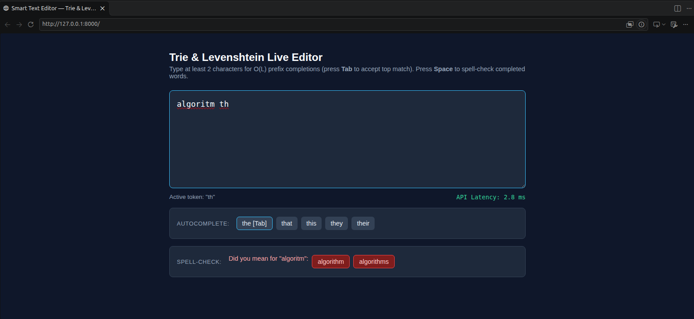

# Fast Autocomplete & Spell-Check API

A high-performance prefix autocomplete and spell-checking engine built from scratch in Python using a **suffix-cached Trie** and **Levenshtein edit-distance** algorithms, served via **FastAPI** with a real-time interactive text editor frontend.



## Key Engineering Highlights

* **$O(L)$ Prefix Autocomplete:** Instead of traversing entire subtrees on every keystroke, `Trie.build_cache()` pre-computes and stores the `top_k` frequency-ranked relative suffixes at every node at startup. Runtime queries traverse strictly $L$ characters (where $L$ is the prefix length) and return ranked completions immediately.
* **Frequency-Weighted Ranking:** Indexed against a 10,000+ word Google English frequency corpus so common words (`the`, `that`, `this`) naturally outrank rare terms, with deterministic alphabetical tie-breaking.
* **Levenshtein Distance Spell-Checker:** Computes minimum single-character edits (insertions, deletions, substitutions) with configurable `max_distance` bounds to rank closest dictionary matches for misspelled tokens.
* **Interactive Live Text Editor:** Vanilla HTML/CSS/JavaScript frontend featuring input debouncing, inline wavy typo underlines, `Tab`-to-complete keyboard shortcuts, and a live round-trip API latency monitor (~3.7 ms local response time).

---

## Algorithmic Complexity

| Operation | Time Complexity | Space Complexity | Notes |
| :--- | :--- | :--- | :--- |
| **Trie Insertion** | $O(M)$ | $O(N \cdot M)$ | $M$ = word length, $N$ = dictionary size |
| **Cache Pre-computation** | $O(V \cdot K \log K)$ | $O(V \cdot K)$ | One-time DFS pass across $V$ Trie nodes storing top $K$ suffixes |
| **Prefix Autocomplete** | $O(L)$ | $O(1)$ auxiliary | $L$ = prefix length; reads pre-sorted cache directly |
| **Spell-Check Query** | $O(N \cdot W_1 \cdot W_2)$ | $O(\min(W_1, W_2))$ | Filtered by `max_distance` threshold |

---

## Project Structure

```text
fast-autocomplete-api/
├── assets/
│   └── demo.png            # Live editor UI screenshot
├── data/
│   └── words.txt           # 10,000+ frequency-ranked English corpus + tech terms
├── src/
│   ├── main.py             # FastAPI application, startup indexing, and REST endpoints
│   ├── trie.py             # Custom Trie & TrieNode with top-K suffix caching
│   └── spellcheck.py       # Levenshtein edit-distance calculation & suggestion ranking
├── static/
│   └── index.html          # Real-time debounced text editor frontend
├── tests/
│   ├── test_core.py        # Unit tests for Trie caching, ranking, and Levenshtein logic
│   └── test_api.py         # Integration tests using FastAPI TestClient
└── requirements.txt
```

---

## Quickstart & Local Setup

1. **Clone the repository and create a virtual environment:**
   ```bash
   git clone [https://github.com/CharlesFortuin/fast-autocomplete-api.git](https://github.com/CharlesFortuin/fast-autocomplete-api.git)
   cd fast-autocomplete-api
   python3 -m venv .venv
   source .venv/bin/activate
   ```

2. **Install dependencies:**
   ```bash
   pip install -r requirements.txt
   ```

3. **Start the FastAPI server:**
   ```bash
   uvicorn src.main:app --reload
   ```

4. **Explore the app:**
   * **Live Interactive Editor:** Open `http://127.0.0.1:8000/`
   * **Interactive Swagger API Docs:** Open `http://127.0.0.1:8000/docs`

---

## API Reference

### `GET /autocomplete`
Returns top-$K$ frequency-ranked completions for a given prefix.
* **Query Parameters:** `prefix` (string, min length 1)
* **Example Request:** `GET /autocomplete?prefix=th`
* **Example Response:**
  ```json
  {
    "query": "th",
    "suggestions": ["the", "that", "this", "they", "their"]
  }
  ```

### `GET /spellcheck`
Returns ranked spelling corrections within a maximum edit distance.
* **Query Parameters:** `word` (string, min length 1), `max_distance` (int, `1–3`, default `2`)
* **Example Request:** `GET /spellcheck?word=algoritm&max_distance=2`
* **Example Response:**
  ```json
  {
    "target": "algoritm",
    "suggestions": ["algorithm"]
  }
  ```

---

## Running Tests

Execute the automated `pytest` unit and endpoint integration suite:
```bash
pytest -v
```
